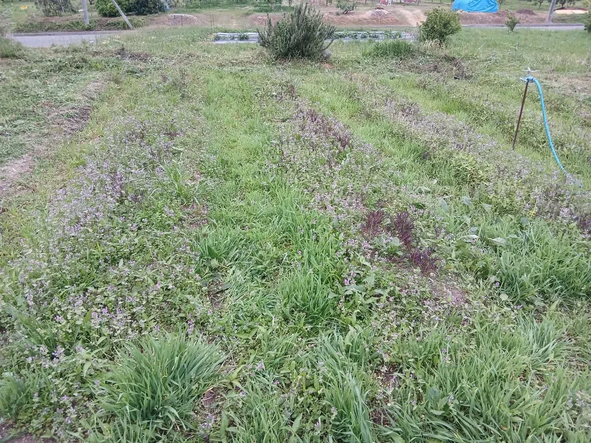
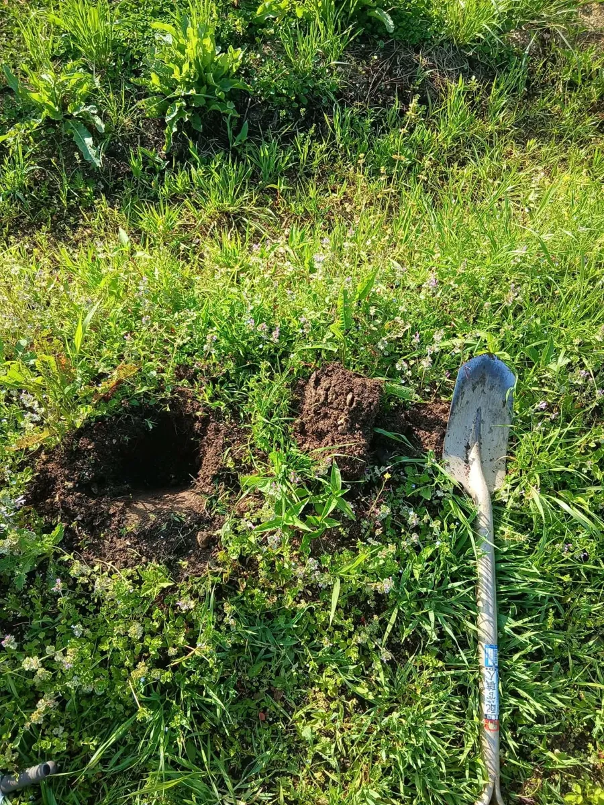
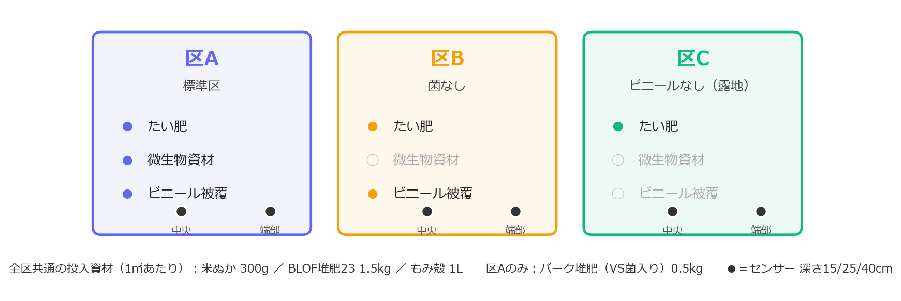
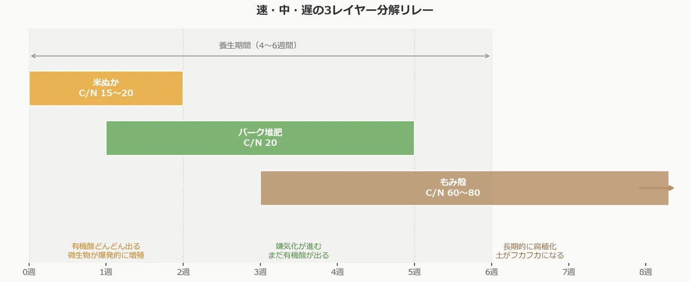
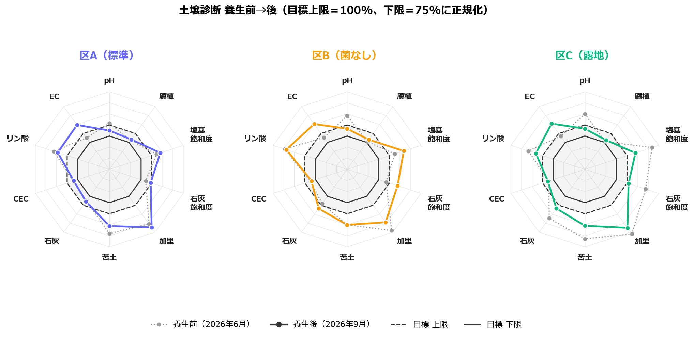

<link rel="stylesheet" href="/css/soil-temp.css">

圃場：みよし市三好町 ／ 期間：2026年7月20日〜8月15日（27日間） ／ 土壌診断：JAあいち豊田（養生前 2026年6月・養生後 2026年9月） ／ 地温：DS18B20 × 21本・30分間隔

  

最高地温

49.0 ℃（区A・中央15cm）

  

40℃以上の継続

211 時間（区A）

  

pH

7.4 → 6.6（区C・最大変化）

  

EC

0.2 → 0.5 mS/cm（3区とも倍増）

## 1. 何を確かめたかったか

畑を透明ビニールで覆い、真夏の日射で土を加熱する「太陽熱養生」。有機物と微生物資材を先に入れておくと、ビニールの下で発酵が重なり、消毒以上の効果があるとされます（『BLOF理論で有機菜園』）。自分の畑で、**地温は本当に上がるのか・微生物資材で何が変わるのか・土の化学性はどう動くのか**を数字で確かめるのが目的です。

  <figure><figcaption>養生前の圃場（2026年5月）。ホトケノザなど春草が一面に出ていた。この雑草の種子を熱で減らしたいというのが動機の一つ</figcaption></figure>
  <figure><figcaption>土壌診断用の採土。各区1点、深さ15cmまでをスコップで切り出し、風乾してJAへ</figcaption></figure>

3区画を隣接して設け、条件を1つずつ外しました。区どうしの差がそのまま「抜いた条件の効果」になる構成です。

<figure class="fig-wide"><figcaption>3試験区の処理と投入資材。区A−区B＝微生物資材の効果、区B−区C＝ビニール被覆の効果</figcaption></figure>

**投入資材（1㎡あたり）**：米ぬか 300g／BLOF堆肥23（C/N比23）1.5kg／もみ殻 1L。区Aにはこれに加えて、VS菌（放線菌を含む有用微生物群）の接種源としてバーク堆肥「栽培名人 野菜の堆肥」0.5kg。分解速度の違う有機物を重ね、米ぬか→堆肥→もみ殻の順に微生物のエサが続くように組みました。肥料分の少ない資材を選んだのは、養生前の診断でリン酸と塩基が過剰だったためです。

<figure class="fig-wide"><figcaption>投入資材の分解リレー（計画時の図）。実際の中堆肥はBLOF堆肥23（C/N比23）に差し替えた</figcaption></figure>

各区に温度センサーを7本（中央・端部 × 深さ15/25/40cm、外気温1本）埋め、30分ごとに記録しました。

---

## 2. 地温：ビニールの効果ははっきり、55℃には届かず

| 位置 | 区A（標準） | 区B（菌なし） | 区C（露地） |
|---|---|---|---|
| 中央15cm 最高 | **49.0 ℃** | 41.9 ℃ | 36.9 ℃ |
| 中央25cm 最高 | 40.2 ℃ | 37.4 ℃ | 32.8 ℃ |
| 中央40cm 最高 | 33.4 ℃ | 33.2 ℃ | 31.0 ℃ |
| 中央15cm 40℃以上 | **211 時間** | 25 時間 | 0 時間 |
| 積算温度（27日） | 1,193 ℃・日 | 1,079 ℃・日 | 915 ℃・日 |

  <h3>積算温度の推移／各区の土壌センサー6本の日最高温度を累積・センサー個体差補正済み</h3>
  
データを読み込み中…

  <canvas id="rep-chart-accum"></canvas>

- **ビニール被覆の効果（区B − 区C）**：積算温度で +164 ℃・日（+18%）。被覆区だけが40℃を超えた。
- **効いたのは深さ15cmまで**。25cmで40℃前後、40cmは外気温に近い。
- **55℃を3日以上**（種子死滅の目安）には届かなかった。最高でも49.0℃。
- **微生物資材の効果（区A − 区B）**：+115 ℃・日（+11%）、中央15cmで最高 7.1℃差。ただしビニール撤去後の露地期間でも区Aは区Bより約0.8℃高く、**差の3割ほどは区画そのものの差**。発酵熱は「あったと思われる」止まり。

詳細は [②-2 結果](/projects/soil-temp/solarization-result/) を参照。

---

## 3. 土壌診断：pHは目標に入り、ECは倍になった

JAあいち豊田の診断（土壌100gあたり、目標はにんにく基準）。灰色の点線が養生前、色付きの実線が養生後です。内側の実線（下限）と点線（上限）の間に入っていれば適正。

<figure class="fig-wide"><figcaption>3区とも pH が上限の外から枠内へ入り、EC が枠の外へ飛び出した。右下（苦土・加里・塩基飽和度）の過剰は形がほぼ変わらない</figcaption></figure>

| 項目 | 目標 | 区A 前→後 | 区B 前→後 | 区C 前→後 |
|---|---|---|---|---|
| **pH** | 6.2–6.8 | 6.9 → **6.5** | 7.3 → **6.6** | 7.4 → **6.6** |
| **EC** mS/cm | 0.1–0.30 | 0.20 → **0.49** | 0.21 → **0.51** | 0.24 → **0.52** |
| リン酸 mg | 30–50 | 75.1 → 67.8 | 88.0 → 85.2 | 77.0 → 62.8 |
| 交換性石灰 mg | 約260–330 | 295.8 → 299.1 | 311.3 → 338.0 | 393.1 → 337.9 |
| 交換性苦土 mg | 約45–57 | 71.2 → 65.0 | 64.0 → 64.1 | 75.4 → 64.8 |
| 交換性加里 mg | 約41–52 | 66.6 → 69.8 | 72.6 → 65.2 | 75.6 → 70.2 |
| 塩基飽和度 % | 85–100 | 106.9 → 112.3 | 107.7 → 120.5 | 135.5 → 111.8 |
| CEC me | 10–20 | 14.5 → 13.7 | 14.7 → 13.8 | 14.3 → 15.0 |
| 腐植 % | 3–5 | 3.47 → 3.66 | 3.18 → 3.61 | 3.18 → 3.50 |

**pHが3区とも目標範囲に入った。** 養生前は全区が上限超え、B・Cは7台でした。有機物が分解されるときの有機酸と、窒素が硝酸に変わる過程（硝酸化成）で、土が酸性側に動いた典型的な形です。

**ECは倍以上に上がり、3区とも上限0.30を超えた。** 原因はpHと同じで、有機物の分解で無機態窒素（おそらく硝酸態）が出てきたものと考えられます。窒素は未計測なので推定ですが、「pHが下がりECが上がる」は窒素が放出されたときのセットの動きです。**次作の元肥窒素は控えめに**するのが安全です。

**腐植は3区とも微増**（+0.19〜+0.43%）。堆肥ともみ殻の分が乗っています。

**過剰なリン酸・苦土・加里・塩基飽和度は持ち越し。** 肥料分の少ない資材を選んだので悪化はしていませんが、養生で過剰分を抜く効果はありません。JAの処方も窒素・リン酸・加里とも 0 kg/10a です。

**ビニールなしの区Cでも、pHとECはA・Bと同じ向きに同じくらい動いた。** つまり診断値の変化を起こしたのは「投入した有機物と夏の地温」であって、ビニール被覆や微生物資材の効果は、この分析項目には現れていません。被覆の効果は地温（40℃以上211時間 vs 0時間）と、今後の雑草・病害の差で見ることになります。採土は1区1点で、区Cの石灰・塩基飽和度の改善は採土位置の誤差の可能性もあります。

---

## 4. 結論と来季

1. **太陽熱養生は地温を上げた。** 被覆の有無で積算温度が18%違い、被覆区だけが40℃を超え、区Aは211時間維持した。ただし効いたのは深さ15cmまでで、55℃には届かなかった。
2. **土の化学性で動いたのはpH・EC・腐植。** pHは狙いどおり目標範囲に入った。代わりに窒素放出とみられるEC上昇が出た。
3. **過剰なリン酸と塩基は養生では抜けない。** 来季も減肥を続け、緑肥などで吸い出す方向。
4. **微生物資材の効果は断定できない。** 地温では差が出たが区画差と分離できず、診断値には差が出なかった。次は区の割り当てを入れ替えて再現する。
5. **設計の反省。** 差が出たとき処理のものか場所のものかを分けられる設計になっていなかった。「条件を揃えた期間」と「区の入れ替え」を最初から計画に入れる。

地温の算出方法・欠測の扱いは <a href="/projects/soil-temp/solarization-result/#データ">②-2 データ注記</a>、土壌診断の全項目は <a href="https://github.com/nono112002/solar-heat-soil-temp-trial/blob/master/docs/soil_analysis_data.md">リポジトリの soil_analysis_data.md</a> を参照。診断値は診断票からの転記。

  <a href="/projects/soil-temp/solarization-result/">← ②-2 結果</a>
  
  <a href="/projects/soil-temp/mulch-design/">③-1 マルチ比較 / 評価準備 →</a>

