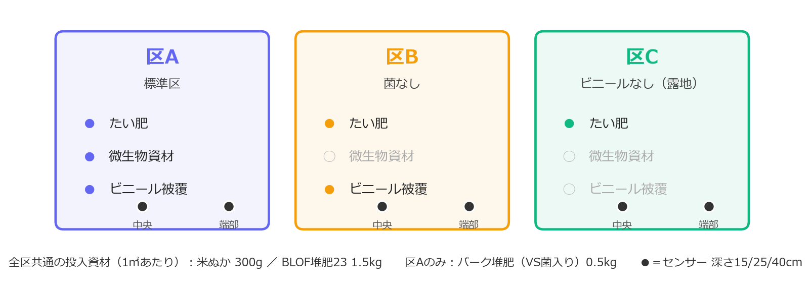
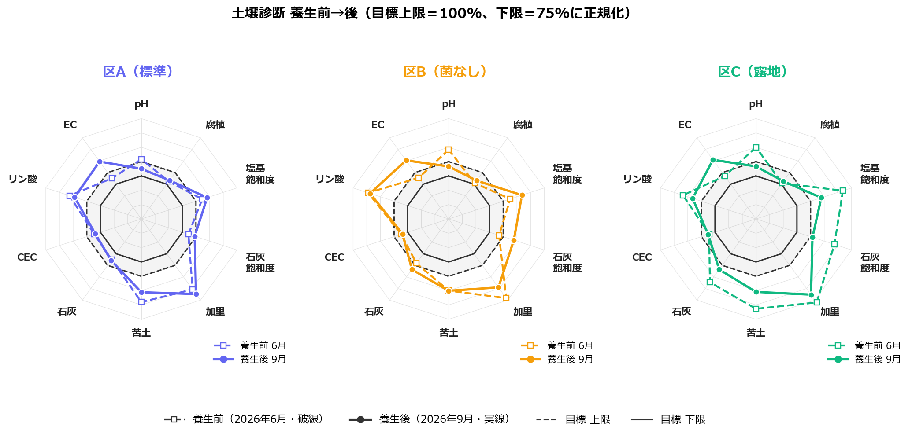

<link rel="stylesheet" href="/css/soil-temp.css">

圃場：みよし市三好町 ／ 養生期間：2026年7月20日〜8月15日（27日間） ／ 地温：温度センサー21本・30分間隔 ／ 土壌診断：JAあいち豊田（養生前 6月・養生後 9月）

  

最高地温

49.0 ℃（区A・中央15cm）

  

40℃以上の継続

211 時間（区A）

  

pH

7.4 → 6.6（区C・最大変化）

  

EC

0.2 → 0.5 mS/cm（3区とも倍増）

## 動機

畑を透明ビニールで覆い、真夏の日射で土を加熱する「太陽熱養生」。地温が40〜50℃を超えると病原菌・雑草種子・土壌害虫が抑えられ、農薬を使わずに土をリセットできるとされます。有機物と微生物資材を先に入れておけば、ビニールの下で発酵が重なり、消毒以上の効果があるとも言われます（『BLOF理論で有機菜園』三澤明久 著）。

ただ、**自分の畑・自分の施工で地温が何℃になるのか**、という数字はどこにもありません。春先の雑草（下の写真）を熱で減らしたい、という実利もあって、測ってみることにしました。知りたかったのは3つです。

1. 地温はどこまで、どの深さまで上がるか
2. 微生物資材を入れると温度の推移は変わるか
3. 土の化学性（pH・EC・腐植）は養生の前後でどう動くか

  <figure><figcaption>養生前の圃場（5月）。ホトケノザなどの春草が一面に出ていた</figcaption></figure>
  <figure><figcaption>土壌診断用の採土。各区1点、深さ15cmまでをスコップで切り出し、風乾してJAへ</figcaption></figure>

---

## 方法

### 試験区

隣接する3区画で、条件を1つずつ外しました。区どうしの差がそのまま「抜いた条件の効果」になります。

<figure class="fig-wide"><figcaption>区A − 区B ＝ 微生物資材の効果、区B − 区C ＝ ビニール被覆の効果</figcaption></figure>

**投入資材（1㎡あたり）**：米ぬか 300g／BLOF堆肥23（C/N比23）1.5kg。区Aにはさらに、VS菌（放線菌を含む有用微生物群）の接種源としてバーク堆肥 0.5kg。分解の速い米ぬかで微生物を一気に増やし、堆肥が引き継ぐ組み合わせです。肥料分の少ない資材を選んだのは、養生前の診断でリン酸と塩基が過剰だったためです。

### 測定

各区に防水温度センサー（DS18B20）を7本。深さ3段階 × 中央／端部の6本と、外気温1本です。自作の測定ユニット（Raspberry Pi Pico W）が30分ごとに読み取り、モバイル回線でサーバーへ送りました。機器の詳細は [① 測定機器](/projects/soil-temp/equipment/) にあります。

| 位置 | 深さ | 狙い |
|---|---|---|
| 中央 | 15 / 25 / 40 cm | 作土層のどこまで加熱されるか |
| 端部 | 15 / 25 / 40 cm | ビニールの縁からどれだけ熱が逃げるか |
| 区外 | — | 外気温（基準） |

**「効いた」と判断する基準**は測る前に決めました。①最高地温が40℃を超えるか、②40℃以上が何時間続くか、③書籍の目安「55℃を3日以上」に届くか。

土壌診断はJAあいち豊田に依頼し、養生前（6月）と養生後（9月、ビニール撤去後のガス抜きを経て）の2回、同じ項目で測りました。

---

## 結果 1：地温

| 位置 | 区A（標準） | 区B（菌なし） | 区C（露地） |
|---|---|---|---|
| 中央15cm 最高 | **49.0 ℃** | 41.9 ℃ | 36.9 ℃ |
| 中央25cm 最高 | 40.2 ℃ | 37.4 ℃ | 32.8 ℃ |
| 中央40cm 最高 | 33.4 ℃ | 33.2 ℃ | 31.0 ℃ |
| 中央15cm 40℃以上 | **211 時間** | 25 時間 | 0 時間 |
| 積算温度（27日） | 1,193 ℃・日 | 1,079 ℃・日 | 915 ℃・日 |

  <button class="zone-toggle active" data-zone="zone-a" style="border-color:#6366f1;background:#6366f1">区A（標準）</button>
  <button class="zone-toggle active" data-zone="zone-b" style="border-color:#f59e0b;background:#f59e0b">区B（菌なし）</button>
  <button class="zone-toggle active" data-zone="zone-c" style="border-color:#10b981;background:#10b981">区C（露地）</button>

  <h3>地温の推移／1時間平均・凡例をクリックで系列を消せます</h3>
  
データを読み込み中…

  <canvas id="sol-chart-raw"></canvas>
  

  <h3>積算温度の推移／各区の土壌センサー6本の日最高温度を累積</h3>
  
データを読み込み中…

  <canvas id="sol-chart-accum"></canvas>

- **ビニール被覆の効果（区B − 区C）はっきり出た。** 積算温度で +164 ℃・日（+18%）。被覆した区だけが40℃を超えた。
- **効いたのは深さ15cmまで。** 25cmで40℃前後、40cmは外気温に近い。浅い作土層はリセットできても、深いところはそのまま。
- **55℃・3日以上には届かなかった。** 最高でも49.0℃で、種子を死滅させる水準には6℃足りない。
- **微生物資材の効果（区A − 区B）は +115 ℃・日（+11%）**、中央15cmの最高地温で 7.1℃の差。

**区Aと区Bの差をそのまま「微生物資材の効果」とは言えません。** 別の区画なので、土や日当たりの差が混ざっています。ビニールを剥がした後の露地状態で5日間測り続けたところ、区Aは区Bより中央15cmで約0.8℃高いままでした。養生中の差 2.7℃（1時間平均）のうち 0.8℃ は区画そのものの差で、処理による差は残りの約1.9℃、という読み方になります。発酵熱は「あったと思われる」止まりです。

---

## 結果 2：土壌診断（養生前→後）

破線が養生前、実線が養生後。内側の実線（目標下限）と点線（目標上限）の間に入っていれば適正です。

<figure class="fig-wide"><figcaption>3区とも pH が枠の外から枠内へ入り、EC が枠の外へ出た。右下（苦土・加里・塩基飽和度）の過剰は形がほぼ変わらない</figcaption></figure>

| 項目 | 目標 | 区A 前→後 | 区B 前→後 | 区C 前→後 |
|---|---|---|---|---|
| **pH** | 6.2–6.8 | 6.9 → **6.5** | 7.3 → **6.6** | 7.4 → **6.6** |
| **EC** mS/cm | 0.1–0.30 | 0.20 → **0.49** | 0.21 → **0.51** | 0.24 → **0.52** |
| リン酸 mg | 30–50 | 75.1 → 67.8 | 88.0 → 85.2 | 77.0 → 62.8 |
| 交換性石灰 mg | 約260–330 | 295.8 → 299.1 | 311.3 → 338.0 | 393.1 → 337.9 |
| 交換性苦土 mg | 約45–57 | 71.2 → 65.0 | 64.0 → 64.1 | 75.4 → 64.8 |
| 交換性加里 mg | 約41–52 | 66.6 → 69.8 | 72.6 → 65.2 | 75.6 → 70.2 |
| 塩基飽和度 % | 85–100 | 106.9 → 112.3 | 107.7 → 120.5 | 135.5 → 111.8 |
| CEC me | 10–20 | 14.5 → 13.7 | 14.7 → 13.8 | 14.3 → 15.0 |
| 腐植 % | 3–5 | 3.47 → 3.66 | 3.18 → 3.61 | 3.18 → 3.50 |

<small>土壌100gあたり。目標はにんにく基準。石灰・苦土・加里の目標はCEC連動のため区ごとに微差あり。</small>

**pHが3区とも目標範囲に入った。** 養生前は全区が上限超えで、B・Cは7台でした。有機物が分解されるときの有機酸と、窒素が硝酸に変わる過程（硝酸化成）で土が酸性側に動いた、典型的な形です。

**ECは倍以上に上がり、3区とも上限0.30を超えた。** 原因はpHと同じで、有機物の分解で無機態窒素（おそらく硝酸態）が出てきたと考えられます。窒素は未計測なので推定ですが、「pHが下がってECが上がる」は窒素が放出されたときのセットの動きです。**次作の元肥窒素は控えめに**するのが安全です。

**腐植は3区とも微増**（+0.19〜+0.43%）。堆肥の分です。

**過剰なリン酸・苦土・加里・塩基飽和度は持ち越し。** 肥料分の少ない資材を選んだので悪化はしていませんが、養生で過剰分を抜く効果はありません。JAの処方も窒素・リン酸・加里とも 0 kg/10a でした。

**ビニールなしの区Cでも、pHとECはA・Bと同じ向きに同じくらい動いた。** 診断値を動かしたのは「投入した有機物と夏の地温」で、ビニール被覆や微生物資材の効果は、この分析項目には現れていません。被覆の効果は地温（40℃以上 211時間 vs 0時間）と、今後の雑草・病害の差で見ることになります。採土は1区1点なので、区Cの石灰・塩基飽和度の改善は採土位置の誤差の可能性もあります。

---

## まとめ

1. **太陽熱養生は地温を上げた。** 被覆の有無で積算温度が18%違い、被覆区だけが40℃を超えて211時間維持した。ただし効いたのは深さ15cmまでで、55℃には届かなかった。
2. **土の化学性で動いたのはpH・EC・腐植。** pHは狙いどおり目標範囲に入り、代わりに窒素放出とみられるEC上昇が出た。
3. **過剰なリン酸と塩基は養生では抜けない。** 減肥を続け、緑肥などで吸い出す。
4. **微生物資材の効果は断定できない。** 地温では差が出たが区画差と分離しきれず、診断値には差が出なかった。次は区の割り当てを入れ替えて再現する。差が出たときに処理のものか場所のものかを分けられる設計を、最初から組んでおく。

---

## データ

  <a class="btn" href="/data/soil-temp/solarization/temperature.json" download>養生期間 温度 (JSON)</a>
  <a class="btn" href="/data/soil-temp/solarization/accumulated.json" download>養生期間 積算温度 (JSON)</a>
  <a class="btn" href="/data/soil-temp/bare-baseline/temperature.json" download>露地期間 温度 (JSON)</a>

温度はセンサー個体差を補正した値（補正値は <a href="/projects/soil-temp/mulch-result/#校正">③-2 校正</a>）。積算温度は各区の土壌センサー6本の日最高温度を日ごとに足した値（℃・日）で、書籍の 800〜900℃ とは計算方法が違うため直接比較できない。8/15 はビニール撤去の13時までの部分計測。区A・Bの7本目は 7/28 に外気温から土壌5cmへ差し替えたため積算に含めていない。区C端部40cmは校正値が取れず補正後の値がない。読み取り失敗の 0.0℃（区A端部15cm、53件）は除外。土壌診断の値は診断票からの転記。

  <a href="/projects/soil-temp/equipment/">← ① 測定機器</a>
  
  <a href="/projects/soil-temp/mulch-design/">③-1 マルチ比較 / 評価準備 →</a>

